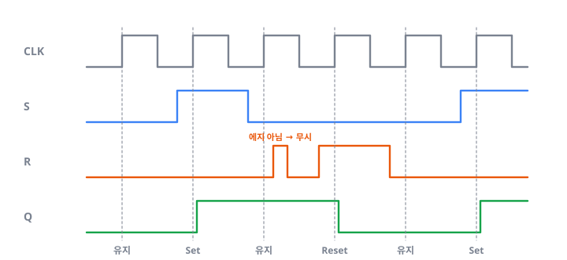
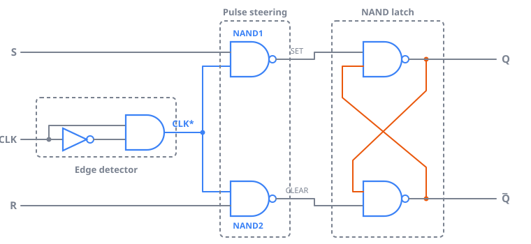
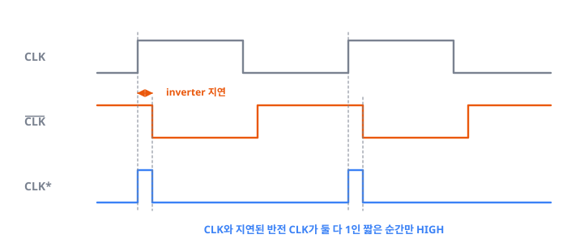
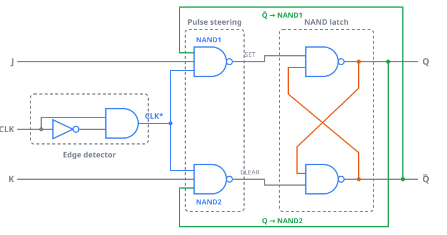
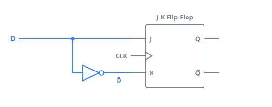
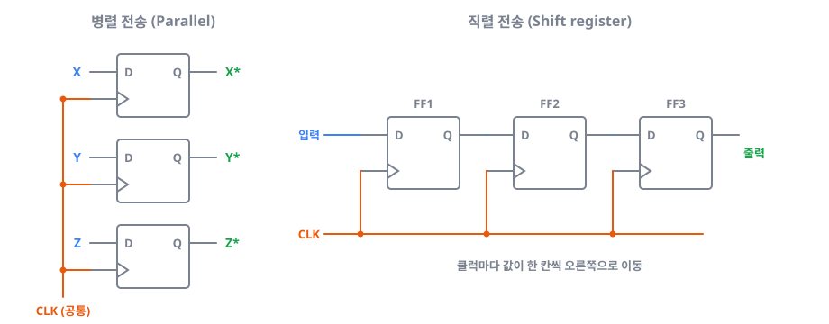

> 디지털 논리회로 Chapter 5를 공부하며 정리한 글입니다. (2/2)
>
> Latch, Clock 에지(PGT/NGT), Setup/Hold time은 [1편]()에서 다뤘습니다.

---

## 1. Clocked Flip-Flop

Flip-Flop을 S-R, J-K, D 순서로 살펴보겠습니다.

### 1.1 S-R Flip-Flop

S-R Flip-Flop은 1편의 Latch에 **CLK가 추가된 것**이라고 생각하면 됩니다. Clock 에지에서만 동작합니다.

| S | R | CLK 에지 후 $Q$ |
|---|---|-----------------|
| 0 | 0 | 변화 없음       |
| 1 | 0 | 1               |
| 0 | 1 | 0               |
| 1 | 1 | 사용 안 함      |

_$Q$는 PGT 순간의 S, R 값으로만 바뀌며, 에지 사이에서 R이 잠깐 1이 되어도 무시됩니다_

**내부 구조**

Edge-triggered S-R Flip-Flop은 세 부분으로 구성됩니다.

| 부분                         | 구성          | 역할                                            |
|------------------------------|---------------|-------------------------------------------------|
| Edge detector (에지 검출 회로) | Inverter + AND | Clock 에지에서 아주 짧은 Pulse(CLK*)를 만듭니다 |
| Pulse steering (펄스 구동 회로) | NAND 2개      | S, R 값에 따라 CLK*를 SET 쪽 또는 CLEAR 쪽으로 보냅니다 |
| NAND Latch                   | NAND 2개      | 값을 기억합니다                                 |

즉 **NAND 4개에 Edge detector를 더한 구조**입니다.

_Edge detector → Pulse steering(NAND1, NAND2) → NAND Latch_

Edge detector는 **Inverter의 지연**을 이용합니다. Inverter를 거친 $\overline{\text{CLK}}$는 조금 늦게 바뀌기 때문에, 상승 에지 직후 아주 짧은 순간 동안 CLK와 $\overline{\text{CLK}}$가 둘 다 1이 됩니다. 이 둘을 AND하면 그 순간에만 HIGH인 짧은 Pulse **CLK\***가 만들어집니다.

_Inverter 지연 동안만 CLK와 반전 CLK가 같은 값이 되어 CLK\*가 생깁니다_

- PGT용은 AND 게이트를 씁니다.
- NGT용은 입력에 동그라미가 붙은 AND 게이트를 씁니다.

이 짧은 Pulse가 S, R 값에 따라 Latch의 SET 쪽이나 CLEAR 쪽으로 전달됩니다. 예를 들어 $S = 1, R = 0$이면 CLK*가 NAND1을 지나며 반전되어 Latch의 SET에 LOW Pulse가 들어가고 $Q = 1$이 됩니다.

### 1.2 J-K Flip-Flop

J-K Flip-Flop은 S-R에서 두 입력이 **1 1일 때 사용할 수 없는 비효율성**을 해결한 진화 버전입니다.

| J | K | CLK 에지 후 $Q$         |
|---|---|-------------------------|
| 0 | 0 | 변화 없음               |
| 1 | 0 | 1                       |
| 0 | 1 | 0                       |
| 1 | 1 | $\overline{Q}$ (Toggle) |

$J = K = 1$이면 Clock 에지마다 이전 상태의 반대가 되는데, 이것을 **Toggle 모드**라고 합니다. 나머지 입력은 S-R과 같습니다.

**내부 구조**

앞의 S-R 회로에서 출력 $Q$를 K 쪽 Pulse steering NAND(NAND2)에, $\overline{Q}$를 J 쪽 NAND(NAND1)에 되먹임하면 만들 수 있습니다.

_초록색 선: $Q$ → NAND2, $\overline{Q}$ → NAND1 Feedback_

그래서 $J = K = 1$일 때,

- $Q = 0$이면 $\overline{Q} = 1$이므로 NAND1만 열려 **Set**됩니다.
- $Q = 1$이면 NAND2만 열려 **Reset**됩니다.

> **Feedback 덕분에 한쪽 NAND만 열리므로, 1 1 입력이 "사용 안 함"이 아니라 Toggle이 됩니다.**

### 1.3 D Flip-Flop

D Flip-Flop은 **입력이 하나**인 Flip-Flop입니다. Clock 에지에서 $D = 1$이면 $Q = 1$, $D = 0$이면 $Q = 0$이 됩니다.

| D | CLK 에지 후 $Q$ |
|---|-----------------|
| 0 | 0               |
| 1 | 1               |

J-K Flip-Flop의 J에 D를, K에 Inverter를 거친 $\overline{D}$를 연결해서 구성할 수 있습니다.

_J와 K가 항상 반대이므로 J-K의 Set/Reset 동작만 남습니다_

---

## 2. 데이터 전송

### 2.1 병렬 전송 (Parallel transfer)

비트마다 D Flip-Flop을 하나씩 두고 CLK를 공통으로 연결합니다. Clock 에지 한 번에 X, Y, Z 값을 X\*, Y\*, Z\*로 **동시에** 옮깁니다.

### 2.2 직렬 전송 (Serial transfer)

**Shift register**를 사용합니다. 각 Flip-Flop이 왼쪽 Flip-Flop의 출력을 입력으로 받도록 연결되어 있어서, Clock마다 저장된 값이 한 칸씩 이동합니다. Clock은 모든 Flip-Flop에 동시에 들어가고, 각 Flip-Flop은 에지 **직전**의 왼쪽 값을 받습니다.

_병렬: 공통 CLK로 한 번에 전송 / 직렬: Shift register로 Clock마다 한 칸씩 이동_

값이 한 번에 여러 칸 건너뛰지 않는 이유는 Flip-Flop의 출력이 **Propagation delay(전파지연)**만큼 늦게 바뀌기 때문입니다.

> **Propagation delay가 Hold time보다 길어야 다음 Flip-Flop이 바뀌기 전의 값을 확실하게 읽을 수 있습니다.**

### 2.3 비교

N비트를 보낼 때를 비교하면 다음과 같습니다.

| 방식 | Clock 수 | 선 수 | 특징                     |
|------|----------|-------|--------------------------|
| 병렬 | 1번      | N개   | 빠릅니다                 |
| 직렬 | N번      | 1개   | 경제적이고 회로가 간단합니다 |

어떤 방식을 쓸지는 시스템의 응용 분야와 규격에 따라 달라집니다.

---

## 3. 정리

- **S-R**은 Latch + Edge detector + Pulse steering이고, **J-K**는 여기에 출력 Feedback을 더해 1 1을 Toggle로 바꿨으며, **D**는 J-K의 K에 $\overline{D}$를 넣은 것입니다.
- 병렬 전송은 빠르고, Shift register를 쓰는 직렬 전송은 경제적입니다.
