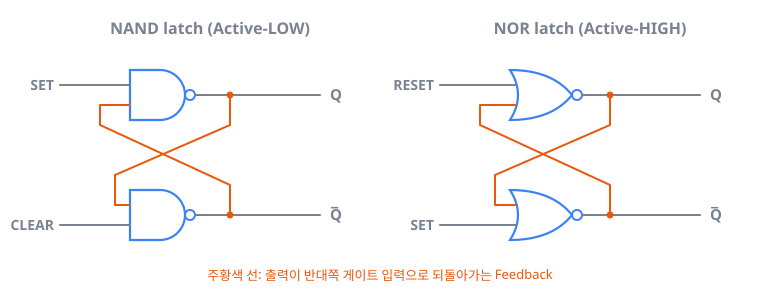
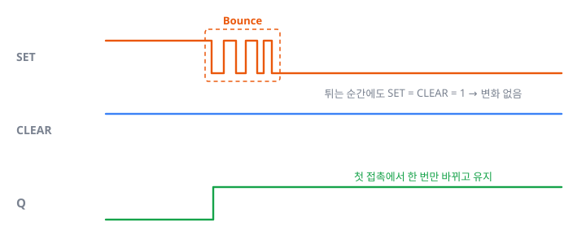
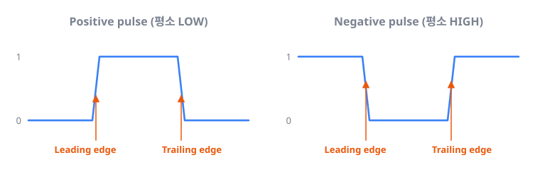
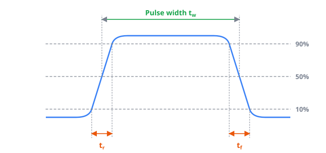
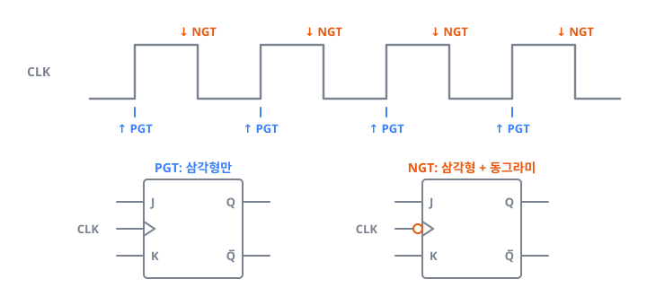
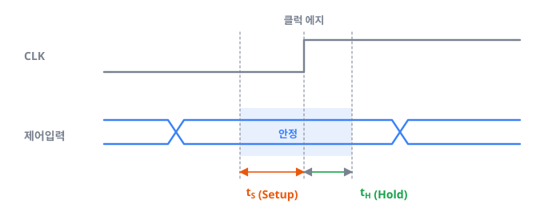

> 디지털 논리회로 Chapter 5를 공부하며 정리한 글입니다. (1/2)

---

## 1. Latch: 가장 단순한 기억소자

지금까지 배운 논리회로에 **기억소자**를 추가한다고 생각하면 됩니다. 일반적인 디지털 시스템은 기억소자와 조합논리회로(Combinational logic)로 구성되는데, Flip-Flop은 논리게이트를 조합해 만든 기억소자입니다.

- 출력은 $Q$와 $\overline{Q}$ 두 개이며, $\overline{Q}$는 항상 $Q$의 반전입니다.
- 가장 간단한 형태인 **Latch**는 SET과 CLEAR(= RESET) 입력을 가집니다.

_두 게이트의 출력이 서로의 입력으로 되돌아가는(Feedback) 구조가 값을 붙잡습니다_

### 1.1 NAND Latch

NAND 게이트 두 개로 구성한 Latch의 진리표입니다.

| SET | CLEAR | 출력                  |
|-----|-------|-----------------------|
| 1   | 1     | 변화 없음             |
| 1   | 0     | $Q = 0$ (Clear/Reset) |
| 0   | 1     | $Q = 1$ (Set)         |
| 0   | 0     | 사용 안 함            |

회로 그림과 같이 봐도 처음에는 이해가 잘 안 될 수 있습니다. 이렇게 생각하면 쉽습니다.

1. 평소에는 두 입력 모두 **1 1**을 유지하고, 그 상태에서 어떤 $Q$가 출력되고 있습니다. SET = CLEAR = 1일 때는 $Q = 0$, $Q = 1$ 두 출력 상태가 모두 가능합니다.
2. 이때 **잠깐** SET이나 CLEAR가 0이 되면 출력이 바뀌거나 유지됩니다.
3. 입력이 다시 1로 돌아와도 출력이 Feedback으로 되돌아와 값을 붙잡고 있기 때문에, 바뀐 값이 유지됩니다.

> **입력이 원래대로 돌아와도 출력이 Feedback으로 자기 값을 붙잡고 있는 것, 이것이 기억의 원리입니다.**

두 입력이 **0 0**일 때는 사용하지 않습니다. 둘 다 0이면 $Q = \overline{Q} = 1$이 되어 반전 관계가 깨집니다. 또 다시 1로 돌아갈 때 어느 입력이 먼저 HIGH가 되느냐에 따라 결과가 달라지고, 동시에 HIGH가 되면 결정할 수 없어서 출력을 예측할 수 없습니다.

### 1.2 Debounce 회로

기계적 스위치는 접점이 닿을 때 여러 번 튀는 **Bounce(바운스)** 현상이 생깁니다. NAND Latch를 쓰면 스위치가 튀어서 두 입력이 모두 1이 되어도 "변화 없음" 상태이므로 출력이 흔들리지 않습니다. 이것을 **Debounce 회로**라고 합니다.

_SET 입력이 튀어도 첫 접촉에서 한 번만 Set되고 이후에는 유지됩니다_

### 1.3 NOR Latch

NOR Latch는 NAND Latch와 반대로 입력이 HIGH일 때 동작합니다(**Active-HIGH**).

| SET | RESET | 출력                          |
|-----|-------|-------------------------------|
| 0   | 0     | 변화 없음                     |
| 1   | 0     | $Q = 1$                       |
| 0   | 1     | $Q = 0$                       |
| 1   | 1     | 사용 안 함 ($Q = \overline{Q} = 0$) |

| 구분         | NAND Latch      | NOR Latch       |
|--------------|-----------------|-----------------|
| 평소 입력    | 1 1             | 0 0             |
| 동작 입력    | 0 (Active-LOW)  | 1 (Active-HIGH) |
| 사용 안 함   | 0 0 → $Q = \overline{Q} = 1$ | 1 1 → $Q = \overline{Q} = 0$ |

---

## 2. Digital Pulse

**Pulse**는 신호가 평소의 비활성 상태에서 반대 상태로 잠깐 바뀌었다가 돌아오는 것인데, 돌아온 뒤에도 그 영향이 시스템에 남아 있는 신호입니다. 앞의 Latch에서 입력을 "잠깐" 0으로 만든 것이 바로 Pulse입니다.

### 2.1 Positive pulse와 Negative pulse

- **Positive pulse**: 평소 LOW였다가 HIGH로 변할 때 기능이 수행됩니다.
- **Negative pulse**: 평소 HIGH였다가 LOW로 변할 때 기능이 수행됩니다.

**Leading edge**와 **Trailing edge**는 각각 Pulse의 시작과 끝에 있는 천이를 가리킵니다.

> **Leading edge가 곧 상승 에지(Rising edge)라는 뜻은 아닙니다.** Positive pulse에서는 Leading edge가 상승 에지이지만, Negative pulse에서는 Leading edge가 하강 에지입니다.

_Leading edge는 Pulse의 "시작" 천이이며, 방향은 Pulse 종류에 따라 다릅니다_

### 2.2 Rise time, Fall time, Pulse width

| 용어                     | 정의                                                        |
|--------------------------|-------------------------------------------------------------|
| Rise time ($t_r$)        | HIGH 레벨 전압의 10% → 90%까지 올라가는 시간                |
| Fall time ($t_f$)        | HIGH 레벨 전압의 90% → 10%까지 내려가는 시간                |
| Pulse width ($t_w$)      | Leading edge와 Trailing edge가 각각 50%를 지나는 두 지점 사이의 시간 |

0~100%가 아니라 10~90%로 측정하는 이유는, 실제 Pulse가 이상적으로 수직으로 움직이지 않고 시작과 끝 부분이 완만하게 휘어 있어 정확한 시점을 잡기 어렵기 때문입니다. 그래서 비교적 곧게 변하는 10~90% 구간으로 측정합니다.

_양 끝이 휘어 있으므로 곧게 변하는 10~90% 구간으로 측정합니다_

---

## 3. Clock과 동기 시스템

### 3.1 동기(Synchronous)와 비동기(Asynchronous)

- **동기**: Clock이 천이할 때에만 출력이 변하는 회로입니다.
- **비동기**: 앞의 Latch처럼 입력이 바뀌면 Clock과 상관없이 바로 출력이 바뀌는 회로입니다.

대부분의 디지털 시스템은 동기 방식이고, 동기 시스템의 동작 속도는 Clock 주기에 의존합니다. Clock은 **CLK**로 부르겠습니다(CK, CP라고도 씁니다).

### 3.2 PGT와 NGT

| 종류 | 천이            | 회로 기호 (CLK 입력)     |
|------|-----------------|--------------------------|
| PGT (Positive-Going Transition) | 0 → 1, 상승 에지 | 삼각형만                 |
| NGT (Negative-Going Transition) | 1 → 0, 하강 에지 | 삼각형 + 동그라미        |

_CLK 입력에 동그라미가 있으면 하강 에지(NGT)에서 동작합니다_

동기 회로에서는 Clock에 의해서만 출력이 변할 수 있습니다. Clock이 HIGH나 LOW로 유지되는 동안에는 출력이 변하지 않고, Clock의 **에지(천이) 순간에만** 제어입력에 의해 출력이 변합니다.

> **제어입력은 '무엇'을, CLK는 '언제'를 결정합니다.**

제어입력은 Clock 에지가 오기 전에는 출력에 영향을 주지 않으므로 **동기 제어입력(Synchronous control input)**이라고 부릅니다.

### 3.3 Setup time과 Hold time

제어입력에는 Clock 에지를 기준으로 Setup time과 Hold time이 존재합니다. 두 시간 동안 **제어입력이 안정적으로 유지**되어야 합니다.

- **Setup time ($t_S$)**: Clock 에지 **전에** 제어입력이 미리 준비되어 유지되어야 하는 시간입니다.
- **Hold time ($t_H$)**: Clock 에지 **후에** Flip-Flop이 입력을 다 읽을 때까지 제어입력이 유지되어야 하는 짧은 시간입니다.

_Clock 에지를 사이에 두고 $t_S + t_H$ 동안 제어입력이 바뀌면 안 됩니다_

이 조건을 어기면 Clock 에지가 와도 Flip-Flop이 제대로 응답한다고 보장할 수 없습니다.

---

## 4. 정리

- Latch는 Feedback으로 값을 붙잡는 가장 단순한 기억소자입니다. NAND Latch는 Active-LOW, NOR Latch는 Active-HIGH입니다.
- Pulse의 Rise/Fall time은 10~90%, Pulse width는 50% 지점 사이로 측정합니다.
- 동기 회로는 Clock 에지(PGT/NGT)에서만 출력이 바뀌며, 제어입력은 Setup time과 Hold time 동안 유지되어야 합니다.

> 다음 편: [S-R·J-K·D Flip-Flop의 내부 구조와 데이터 전송]()
