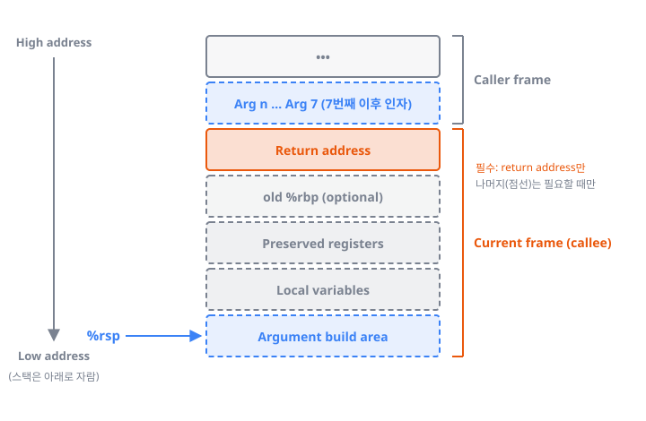
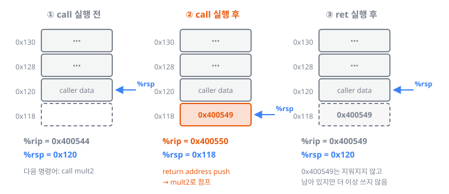
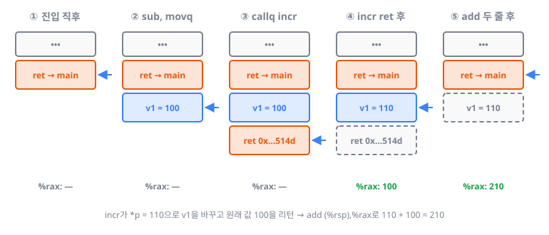
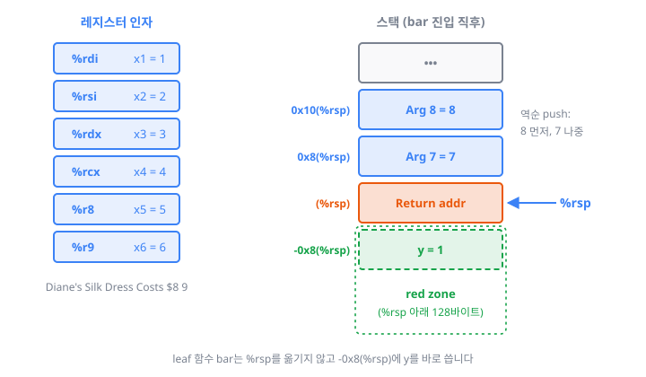

> 시스템 프로그래밍 강의(CSAPP 3rd Edition, Chapter 3.7)를 공부하며 정리한 글입니다. 예제는 x86-64 / Linux 기준입니다.

---

## 1. 들어가며: 이번 장의 주인공 `%rsp`

지금까지는 함수 하나가 어떻게 실행되는지를 봤습니다. 이번 장에서는 **여러 Procedure(함수)가 서로를 호출할 때 바이너리 수준에서 무슨 일이 일어나는지**를 봅니다. 이후에는 복잡한 데이터 타입(Array, Pointer, Structure)이 메모리에 어떻게 표현되는지, Library와 Linking, OS와의 인터페이스로 시야를 넓혀 갑니다.

먼저 알아야 할 레지스터는 두 개입니다.

| 레지스터 | 이름 | 의미 |
|----------|------|------|
| `%rip` | Program Counter (PC) | **다음에 실행할 명령어의 주소** |
| `%rsp` | Stack Pointer (SP) | **스택의 top 주소** |

지난 장의 주인공이 Condition code를 담는 `%rflags`였다면, 이번 장의 주인공은 `%rsp`입니다. 함수 호출과 `%rsp`의 변화는 떼어 놓을 수 없습니다.

---

## 2. 왜 Procedure를 쓰는가

Procedure(함수)는 특정 작업을 수행하는 **재사용 가능한 코드 블록**입니다. OS, Application, Library 모두 Procedure 단위로 구성됩니다. 장점은 재사용성, 추상화, 가독성·모듈화입니다.

- **재사용**: 어떤 함수를 100번 호출해야 하는데 Procedure가 없다면 그 코드를 100번 복사해 넣어야 합니다. 코드 크기가 폭발할 뿐 아니라, 재귀처럼 몇 번 호출될지 컴파일 시점에 알 수 없는 경우에는 아예 불가능합니다.
- **동적 할당**: 함수의 지역 변수는 그 함수가 실제로 호출될 때만 메모리를 잡으면 됩니다. 드물게 실행되는 함수의 큰 지역 변수를 미리 잡아 둘 필요가 없습니다.
- 호출마다 **서로 다른 런타임 상태**(예: return address)를 가집니다.

ISA가 Procedure를 위해 기본으로 제공하는 것은 `call`과 `ret`입니다. `jmp`와 다른 점은, `call`로 간 곳(callee)이 끝나면 **반드시 부른 곳(caller)으로 돌아와야 한다**는 것입니다.

- **Caller**: 함수를 부르는 쪽입니다.
- **Callee**: 부름을 받는 쪽입니다.

이 역할은 상대적입니다. `main → A → B`라면 A는 main의 callee이면서 B의 caller입니다. `call` 명령어가 없는 함수, 즉 다른 함수를 부르지 않는 함수는 **Leaf procedure**라고 부릅니다.

---

## 3. 왜 Stack인가

돌아오려면 **돌아갈 주소(Return address)를 어딘가에 저장해야 합니다.** Return address는 `call` 명령어 바로 다음 명령어의 주소이고, 호출마다 다를 수 있습니다. 호출이 중첩되면 이런 주소를 여러 개 보관해야 합니다.

저장할 수 있는 곳은 레지스터 아니면 메모리입니다.

| 선택지 | 문제 |
|--------|------|
| 레지스터 | 개수가 적어서 호출이 깊어지면 결국 부족합니다 |
| 메모리 | 중첩 호출의 return address를 모두 관리할 수 있습니다 |

그래서 x86은 **메모리**를 선택했고, 이 영역을 **Call stack**, 줄여서 Stack이라고 부릅니다.

A → B → C 순으로 호출했다면 C가 끝난 뒤에는 B로, B가 끝난 뒤에는 A로 돌아가야 합니다. 마지막에 들어온 것이 먼저 나가므로 **LIFO(Last-In First-Out)** 구조이고, 그래서 Stack이 딱 맞습니다.

호출 한 번에 필요한 정보의 묶음을 **Stack frame**이라고 합니다. 100번 호출하면 Frame도 100개가 생깁니다.

---

## 4. ABI: 바이너리 수준의 약속

### 4.1 ISA와 ABI

- **ISA (Instruction Set Architecture)**: 하드웨어가 소프트웨어에게 **무엇을 제공하는가**를 정의합니다. 명령어(`movq`, `addq`, `pushq`…), 레지스터(`%rax`~`%r15`), 메모리 주소 지정 방식(64비트 주소, RIP-relative addressing 등)이 여기에 속합니다.
- **ABI (Application Binary Interface)**: 그 ISA를 바이너리 수준에서 **어떻게 사용할 것인가**에 대한 약속입니다.

예를 들어 "리턴 값은 `%rax`에 둔다"는 약속이 있습니다. 누군가 `%rbx`에 리턴 값을 둔다면, 따로 컴파일된 코드끼리는 통신할 수 없습니다. OS, Library, Application이 함께 돌아가려면 모두 같은 ABI를 지켜야 합니다. 즉 ABI는 **컴파일된 프로그램 사이의 바이너리 호환성**을 보장합니다. 이 약속을 지켜야 하는 도구는 Compiler, Linker, Loader입니다.

> **같은 ISA라도 ABI는 다를 수 있습니다.**

- x86-64 Linux / Unix → **System V AMD64 ABI**
- x86-64 Windows → **Microsoft x64 ABI**

### 4.2 System V AMD64 ABI

이 글은 Linux 기준이므로 System V AMD64 ABI(System V x86-64 ABI라고도 합니다)를 따릅니다. 2000년대 초 UNIX System V ABI를 바탕으로 x86-64용으로 만들어졌고, Unix 계열 OS의 사실상 표준입니다. 이름에 AMD64가 붙은 이유는 AMD가 64비트 확장을 먼저 했기 때문이며, x86-64와 같은 것입니다.

System V AMD64 ABI는 두 부분으로 나뉩니다.

| 구분 | 성격 | 예 |
|------|------|----|
| **gABI** (Generic ABI) | 프로세서와 **무관한** 규약 | ELF 실행 파일 포맷 |
| **psABI** (Processor Supplement ABI) | 프로세서에 **종속적인** 규약 | **Calling convention** |

> **Note** "ABI가 뭔가요?"에 "Application Binary Interface"라고만 답하면 부족합니다. "바이너리 수준에서 ISA를 어떻게 사용할지 정한 규약이고, 프로세서 독립적인 gABI와 프로세서 종속적인 psABI로 나뉜다"까지 말할 수 있어야 합니다.

---

## 5. Calling Convention의 4가지 범주

Calling convention은 Procedure가 바이너리 수준에서 어떻게 호출하고 돌아오는지를 정한 규약입니다. **Calling convention이 없으면 따로 컴파일된 코드끼리 통신할 수 없습니다.** Caller와 Callee가 서로에게 묻는 질문으로 보면 네 가지 범주가 자연스럽게 나옵니다.

| 범주 | Caller/Callee의 질문 | System V AMD64의 답 |
|------|---------------------|---------------------|
| **Stack operation** | Frame은 어디에 어떻게 잡는가? | 호출마다 런타임에 Stack frame 할당, 아래로 자람, `%rsp`가 top |
| **Passing control** | 어떻게 가고, 어떻게 돌아오는가? | `call`이 return address push 후 점프, `ret`이 pop 후 점프 |
| **Passing data** | 인자와 리턴 값은 어디에? | 인자 6개까지 `%rdi, %rsi, %rdx, %rcx, %r8, %r9`, 나머지는 스택, 리턴은 `%rax` |
| **Register saving** | 내 레지스터를 덮어쓰지 않을까? | `%rbx, %rbp, %r12~%r15`는 callee가 복원 |

하나씩 보겠습니다.

---

## 6. Stack Operation

### 6.1 push와 pop

x86-64의 Stack은 **높은 주소에서 낮은 주소 방향으로(아래로) 자랍니다.** 그래서 할당하면 `%rsp`가 **감소**하고, 해제하면 **증가**합니다.

```nasm
pushq %rcx        # = subq $8, %rsp      (공간 할당)
                  #   movq %rcx, (%rsp)  (저장)

popq  %rcx        # = movq (%rsp), %rcx  (읽기)
                  #   addq $8, %rsp      (공간 해제)
```

pop을 해도 그 자리의 데이터는 지워지지 않고 남아 있습니다. 그냥 더 이상 쓰지 않을 뿐입니다. 초기화하지 않은 지역 변수에 "쓰레기 값"이 보이는 이유가 여기에 있습니다.

### 6.2 Stack frame의 구성


_Return address만 필수이고, 점선으로 표시한 부분은 필요할 때만 생깁니다_

Stack frame에 반드시 들어가는 것은 **Return address 하나뿐**입니다. 나머지는 **필요할 때만** 들어갑니다.

- **Return address**: `call`이 push합니다 (`%rsp -= 8`).
- **Frame pointer** (`old %rbp`): optional입니다.
- **Local variables**: 꼭 필요할 때만 둡니다 (9장 참고).
- **Arguments**: 7번째 이후 인자만 둡니다.
- **Preserved registers**: 호출 이후에도 값이 살아 있어야 할 때 둡니다.

Stack은 메모리이고 메모리 접근은 레지스터보다 느리기 때문에, 현대 x86-64는 **Stack 사용을 최소화**하는 것을 원칙으로 합니다. 필요한 크기는 **컴파일 시점에 결정**되고, 실제 할당은 호출될 때(런타임) 일어납니다.

### 6.3 `%rbp`(Frame pointer)는 이제 optional

옛날 32비트 x86에서는 Frame의 시작을 가리키는 `%rbp`와 끝(top)을 가리키는 `%rsp`를 둘 다 유지했습니다. x86-64에서는 효율을 위해 `%rbp`를 빼고 `%rsp` 기준으로 모두 계산합니다. `%rbp`를 갱신할 필요가 없어지고, `%rbp`도 범용 레지스터로 쓸 수 있습니다.

```c
long func(long x) { long y = 100; return x + y; }
```

최적화 없이(`-O0`, 기본값) 컴파일하면 `%rbp`로 Frame을 만들고 x와 y를 모두 스택에 씁니다.

```nasm
push %rbp                 # Set up
mov  %rsp,%rbp
mov  %rdi,-0x10(%rbp)     # x를 스택에
movq $0x64,-0x8(%rbp)     # y = 100을 스택에
mov  -0x10(%rbp),%rdx     # Body
mov  -0x8(%rbp),%rax
add  %rdx,%rax
pop  %rbp                 # Finish
ret
```

`-Og`로 컴파일하면 두 줄로 끝납니다. 레지스터만으로 해결되고, 스택에는 return address만 있습니다.

```nasm
lea 0x64(%rdi),%rax       # x + 100
ret
```

> **많은 경우 x86-64 함수는 Return address 외에는 Stack frame이 전혀 필요 없습니다.**

---

## 7. Passing Control: `call`과 `ret`

```nasm
400544: call 400550 <mult2>
400549: movq %rax,(%rbx)     # ← return address
```

**Return address는 `call` 명령어 바로 다음 명령어의 주소**입니다. 위 예에서는 `0x400549`입니다.

| 명령어 | 동작 |
|--------|------|
| `call label` | ① return address를 스택에 push (`%rsp -= 8`) ② label로 점프 (`%rip = label`) |
| `ret` | ① 스택 top에서 return address를 pop (`%rsp += 8`) ② 그 주소로 점프 |

x86-64에서 주소는 8바이트이므로 `%rsp`가 8씩 움직입니다. 이때 16진수 계산에 주의해야 합니다. `0x120 - 8 = 0x118`입니다.

### 7.1 예제: `multstore`가 `mult2`를 호출할 때

```c
void multstore(long x, long y, long *dest) {
    long t = mult2(x, y);
    *dest = t;
}

long mult2(long a, long b) {
    long s = a * b;
    return s;
}
```


_call은 return address를 push하고 점프하며, ret은 그것을 pop하고 돌아옵니다_

| 시점 | `%rip` | `%rsp` | 스택 top |
|------|--------|--------|----------|
| `call` 실행 전 | `0x400544` | `0x120` | caller의 데이터 |
| `call` 실행 후 (`mult2` 진입) | `0x400550` | `0x118` | `0x400549` |
| `ret` 실행 직전 | `0x400557` | `0x118` | `0x400549` |
| `ret` 실행 후 | `0x400549` | `0x120` | caller의 데이터 |

스냅샷 문제를 풀 때는 **먼저 `%rip`를 보고** 다음에 실행할 명령어가 무엇인지 확인하는 습관을 들이면 좋습니다. 함수에 막 들어온 직후라면 스택 top에는 그 함수를 부른 caller의 return address가 있습니다.

---

## 8. Passing Data: 인자와 리턴 값

### 8.1 레지스터 6개, 나머지는 스택

정수와 포인터 인자는 **6개까지 레지스터**로 전달합니다.

| 순서 | 1 | 2 | 3 | 4 | 5 | 6 | 리턴 값 |
|------|---|---|---|---|---|---|---------|
| 레지스터 | `%rdi` | `%rsi` | `%rdx` | `%rcx` | `%r8` | `%r9` | `%rax` |

> **Note** 암기법: **D**iane's **S**ilk **D**ress **C**osts **$8 9** → di, si, dx, cx, 8, 9

7번째부터는 **스택**으로 전달하는데, **역순으로** push합니다. 그래야 스택 top 쪽에 7번째 인자가 와서 callee가 순서대로 읽을 수 있습니다.

```c
void proc(long, long, long, long, long, long, long, long);
void call_proc() {
    proc(1, 2, 3, 4, 5, 6, 7, 8);
}
```

```nasm
pushq  $0x8          # 8번째 인자 먼저
pushq  $0x7          # 7번째 인자
mov    $0x6,%r9d
mov    $0x5,%r8d
mov    $0x4,%ecx
mov    $0x3,%edx
mov    $0x2,%esi
mov    $0x1,%edi
callq  proc
add    $0x10,%rsp    # pop이 아니라 add로 정리
retq
```

### 8.2 왜 `pop`이 아니라 `add $0x10,%rsp`인가

- Callee에 들어간 순간 스택 top에는 return address가 있으므로, callee는 인자를 pop할 수 없습니다. 대신 `0x8(%rsp)`, `0x10(%rsp)`처럼 **오프셋으로 읽기만** 합니다.
- 호출이 끝난 뒤 caller는 그 값을 다시 꺼낼 필요가 없으니, 16바이트(8 × 2)만큼 `%rsp`를 올려서 공간만 해제합니다.

> **스택 인자의 정리는 Caller가 하고, Return address의 제거(`ret`)와 자기 Frame의 정리는 Callee가 합니다.**

---

## 9. 지역 변수가 스택에 올라가는 경우

x86-64에서 지역 변수는 기본적으로 레지스터에 둡니다. 스택에 올라가는 경우는 다음과 같습니다.

1. **레지스터가 부족할 만큼** 지역 변수가 많을 때
2. **주소가 필요할 때**입니다. 레지스터에는 주소가 없기 때문입니다.
   - `&` 연산자를 쓸 때
   - Array·Structure일 때
   - `volatile`일 때 (매번 메모리에서 읽고 쓰라는 뜻이므로)

이 외에 7번째 이후 **인자**, 그리고 뒤에서 볼 **Preserved register**를 보존할 때도 스택을 씁니다.

### 9.1 예제: `call_incr` / `incr`

```c
long incr(long *p, long val) {
    long x = *p;
    long y = x + val;
    *p = y;
    return x;
}

long call_incr() {
    long v1 = 100;
    long inc = 10;
    long v2 = incr(&v1, inc);
    return v1 + v2;
}
```

이해하기 쉽도록 다음 옵션으로 컴파일했습니다. Stack protector를 끄고, 스택을 8바이트로 정렬합니다.

```makefile
CFLAGS=-Og -g -fcf-protection=none -fno-stack-protector -mpreferred-stack-boundary=3
```

```nasm
call_incr:
  0x555555555134  sub    $0x8,%rsp          # v1을 위한 공간 할당
  0x555555555138  movq   $0x64,(%rsp)       # v1 = 100
  0x555555555140  mov    %rsp,%rdi          # 1번째 인자 = &v1
  0x555555555143  mov    $0xa,%esi          # 2번째 인자 = 10
  0x555555555148  callq  0x555555555156 <incr>
  0x55555555514d  add    (%rsp),%rax        # v1 + v2
  0x555555555151  add    $0x8,%rsp          # 공간 해제
  0x555555555155  retq

incr:
  0x555555555156  mov    (%rdi),%rax        # x = *p
  0x555555555159  add    %rax,%rsi          # y = x + val
  0x55555555515c  mov    %rsi,(%rdi)        # *p = y
  0x55555555515f  retq                      # return x
```

- `inc`는 레지스터만으로 충분하지만, **v1은 주소(`&v1`)가 필요하므로 스택에 올라갑니다.** v2는 레지스터(`%rax`)에 둡니다.
- `incr`는 `*p = 110`으로 caller의 v1을 직접 바꾸고, 원래 값 100을 리턴합니다.
- 그래서 결과는 200이 아니라 **110 + 100 = 210**입니다.


_위가 높은 주소, 파란 화살표가 %rsp입니다. ③에서 Return address가 두 개 쌓입니다_

| 단계 | 실행한 명령어 | 상태 |
|------|---------------|------|
| ① | (진입 직후) | 스택 top = main으로 돌아갈 return address |
| ② | `sub`, `movq` | v1 = 100이 스택에, `%rsp -= 8` |
| ③ | `mov`, `mov`, `callq` | `%rdi = &v1`, `%rsi = 10`, return address `0x55555555514d` push, `%rip = 0x555555555156` |
| ④ | `incr` 본문, `retq` | v1 = 110, `%rsi = 110`, `%rax = 100`, return address pop |
| ⑤ | `add (%rsp),%rax`, `add $0x8,%rsp` | `%rax = 210`, v1 공간 해제 |
| ⑥ | `retq` | main으로 돌아감 |

③에서 return address가 두 개 있다는 점에 주의해야 합니다. 위쪽은 main이 call_incr를 부를 때 쌓은 것이고, 아래쪽은 call_incr가 incr를 부를 때 쌓은 것입니다.

> **Note** 컴파일러는 Stack alignment 등 여러 이유로 필요보다 큰 공간을 할당하기도 합니다. 이 예제는 `-mpreferred-stack-boundary=3`(8바이트 정렬)로 그 효과를 없앴습니다.

### 9.2 GDB로 직접 확인하기

```bash
$ make
$ gdb -tui myincr          # 또는 gdb 실행 후 Ctrl-x + a
(gdb) layout split         # 소스와 어셈블리를 같이 보기
(gdb) focus cmd
(gdb) b main
(gdb) r
(gdb) display /x $rip
(gdb) display /x $rsp
(gdb) display /x *(long *) ($rsp)   # 스택 top의 값
(gdb) si                            # 명령어 하나씩 step into
```

`si`로 한 줄씩 넘기면서 `$rip`, `$rsp`, 스택 top의 값이 위 표대로 바뀌는지 확인할 수 있습니다.

### 9.3 Quiz: 파라미터의 주소를 넘기면?

```c
long bar(long z);                long bar(long *z);
long foo(long x) {               long foo(long x) {
    long y = 100;                    long y = 100;
    y = bar(x) + y;                  y = bar(&x) + y;
    return y;                        return y;
}                                }
```

| `bar(x)` | `bar(&x)` |
|----------|-----------|
| `call bar` | `sub $0x8,%rsp` |
| `add $0x64,%rax` | `mov %rdi,(%rsp)` |
| `ret` | `mov %rsp,%rdi` |
| | `call bar` |
| | `add $0x64,%rax` |
| | `add $0x8,%rsp` |
| | `ret` |

`bar(x)`는 세 줄이면 끝나지만, `bar(&x)`로 바꾸면 **파라미터 x도 스택에 저장**해야 합니다. `%rdi`에 있던 x를 스택에 쓰고, 그 주소(`%rsp`)를 다시 `%rdi`로 넘깁니다. 할당·해제 코드가 붙어서 코드가 두 배 이상 길어집니다. **포인터는 꼭 필요할 때만 쓰는 것이 좋습니다.**

### 9.4 Quiz: `volatile`

같은 `foo`에서 `long y`를 `volatile long y`로 바꾸면 다음과 같이 컴파일됩니다.

```nasm
sub  $0x8,%rsp
movq $0x64,(%rsp)     # y = 100 (스택에)
call bar
mov  (%rsp),%rdx      # y 읽기
add  %rdx,%rax
mov  %rax,(%rsp)      # y 쓰기
mov  (%rsp),%rax      # y 다시 읽기
add  $0x8,%rsp
ret
```

`volatile`은 컴파일러에게 **매번 메모리에서 값을 읽으라**고 알리는 키워드입니다. 그래서 y는 레지스터에 둘 수 없고 반드시 스택에 있어야 하며, 읽고 쓸 때마다 매번 메모리에 접근합니다. I/O나 Memory-mapped 장치처럼 정말 필요할 때만 써야 합니다.

### 9.5 Quiz: 인자 8개 전달과 Leaf procedure 최적화

```c
long bar(long x1, long x2, long x3, long x4,
         long x5, long x6, long x7, long x8) {
    volatile long y = 1;
    return x1 + x2 + x3 + x4 + x5 + x6 + x7 + x8 + y;
}
long foo(long x) { return bar(1, 2, 3, 4, 5, 6, 7, 8); }
```

```nasm
bar:
  movq $0x1,-0x8(%rsp)    # y = 1 (%rsp를 옮기지 않음!)
  add  %rsi,%rdi
  add  %rdx,%rdi
  add  %rcx,%rdi
  add  %r8,%rdi
  add  %r9,%rdi
  add  0x8(%rsp),%rdi     # 7번째 인자
  add  0x10(%rsp),%rdi    # 8번째 인자
  mov  -0x8(%rsp),%rax    # y
  add  %rdi,%rax
  ret
```


_인자 1~6은 레지스터, 7·8은 Return address 위에, y는 %rsp 아래 Red zone에 놓입니다_

`call`이 없는 Leaf procedure는 `sub`/`add`로 `%rsp`를 조정하지 않고, **`%rsp` 아래 공간(`-0x8(%rsp)` 등)을 바로 쓰기도 합니다.** 다른 함수를 부르지 않으니 그 공간을 덮어쓸 일이 없기 때문입니다. System V ABI에서는 이 영역(`%rsp` 아래 128바이트)을 **Red zone**이라고 부릅니다.

---

## 10. Register Saving Convention

### 10.1 문제: 호출이 레지스터를 덮어쓴다

정수 레지스터는 16개뿐이라, 호출이 이어지면 레지스터 값이 덮어써질(오염될) 수 있습니다.

```c
long P(long x) { Q(x); return x; }
```

x는 `%rdi`에 들어 있습니다. 그런데 Q도 `%rdi`를 마음대로 쓸 수 있습니다. Q의 내용은 컴파일 시점에 알 수 없으니, 컴파일러는 "Q가 `%rdi`를 덮어쓴다"고 가정해야 합니다. 그러면 Q가 끝난 뒤 `return x`를 할 때 x가 이미 사라져 있을 수 있습니다.

판단 기준은 하나입니다.

> **`call`을 경계로, 그 이후에 해당 레지스터 값을 다시 쓰는가(reuse)?**

| 코드 | 어셈블리 | 보존 필요 |
|------|----------|-----------|
| `Q(x); return 0;` | `call Q` / `mov $0x0,%eax` / `ret` | 없음 (x를 다시 쓰지 않음) |
| `Q(x); return x;` | 아래 참고 | x를 보존해야 함 |

### 10.2 Preserved register (Callee-saved register)

그래서 ABI는 16개 중 일부 레지스터에 약속을 걸어 두었습니다.

- **Preserved (Callee-saved)**: `%rbx, %rbp, %r12, %r13, %r14, %r15`
- 나머지는 **Caller-saved**입니다.

약속의 내용은 이렇습니다.

- **Caller 입장**: Preserved register에 넣어 둔 값은 **call 이후에도 그대로 유지된다**고 믿을 수 있습니다.
- **Callee 입장**: Preserved register를 쓰고 싶으면 **진입할 때 push로 저장하고, 리턴 직전에 pop으로 복원**해야 합니다.

> **"If you use it, you must put it back!"**

```nasm
P:
  push %rbx          # 나도 %rbx를 쓸 거니까, 나의 caller를 위해 원래 값 저장
  mov  %rdi,%rbx     # x를 %rbx로 피신
  call Q             # Q가 %rdi를 덮어써도 %rbx는 안전
  mov  %rbx,%rax     # return x
  pop  %rbx          # %rbx 원래 값 복원
  ret
```

### 10.3 왜 그냥 `%rdi`를 push/pop하지 않을까?

호출이 한 번뿐이면 `push %rdi` / `pop %rdi`가 더 짧습니다. 하지만 함수는 여러 번 호출될 수 있습니다.

```c
long P(long x) { Q(x); Q(x); return x; }
```

```nasm
P:
  push %rbx
  mov  %rdi,%rbx     # x를 한 번만 피신
  call Q
  mov  %rbx,%rdi     # 레지스터 간 복사만으로 x 복원
  call Q
  mov  %rbx,%rax
  pop  %rbx
  ret
```

`%rdi`를 push/pop하는 방식은 **call할 때마다** 메모리에 접근해야 합니다. Preserved register 방식은 처음에 **한 번만** push하고, 그 뒤로는 `%rbx`에서 레지스터 간 복사만 하면 됩니다. 메모리 접근이 줄어듭니다.

### 10.4 보존할 값이 여러 개라면

보존할 값이 두 개라면 Preserved register도 두 개를 쓰고, push 두 번과 pop 두 번이 나옵니다. pop은 push의 **역순**입니다.

```c
long P(long x) {
    long v = Q(x);
    long u = Q(x);
    return x + u + v;
}
```

```nasm
P:
  push %rbp
  push %rbx
  mov  %rdi,%rbx     # x 보존
  call Q
  mov  %rax,%rbp     # v 보존 (다음 call이 %rax를 덮어씀)
  mov  %rbx,%rdi
  call Q             # u = %rax
  add  %rbx,%rax     # u + x
  add  %rbp,%rax     # + v
  pop  %rbx
  pop  %rbp
  ret
```

두 번의 call 동안 x(`%rdi`)와 v(`%rax`)가 살아 있어야 하므로 `%rbx`, `%rbp`에 옮겨 둡니다. 더 필요하면 `%r12`~`%r15`를 쓰고, 그래도 부족하면 스택에 저장합니다.

### 10.5 Quiz: 빈칸 채우기

```nasm
multstore:
  400540: ______________     # (1)
  400541: movq %rdx,%rbx     # dest 보존
  400544: call 400550 <mult2>
  400549: movq %rax,(%rbx)   # *dest = t
  40054c: ______________     # (2)
  40054d: ret

mult2:
  400550: movq  %rdi,%rax    # a
  400553: imulq %rsi,%rax    # a * b
  400557: ret
```

- x(`%rdi`)와 y(`%rsi`)는 mult2 이후에 다시 쓰지 않으니 보존할 필요가 없습니다.
- **dest(`%rdx`)는 call 이후에 다시 씁니다.** 그래서 Preserved register인 `%rbx`로 옮겨 두었습니다.
- `%rbx`를 쓰니까 (1)은 `push %rbx`, (2)는 `pop %rbx`입니다.

---

## 11. 정리

- 현대 x86-64는 **스택 사용을 최소화**하고 레지스터를 적극 활용합니다 (인자 전달, 지역 변수).
- Frame pointer(`%rbp`)는 더 이상 필수가 아니고, `%rsp`만으로 계산합니다.
- **Return address는 반드시 스택에 저장됩니다.**
- 그 외에 Stack frame이 필요한 경우는 다음뿐입니다.
  - 지역 변수가 너무 많아 레지스터에 다 담을 수 없을 때
  - 주소가 필요할 때 (`&`, Array·Structure, `volatile`)
  - 인자가 6개를 넘는 함수를 호출할 때
  - 호출 이후에 다시 쓸 값을 Preserved register로 보존할 때

| Calling convention | 핵심 |
|--------------------|------|
| Stack operation | 아래로 자람, push는 `%rsp -= 8`, pop은 `%rsp += 8` |
| Passing control | `call` = return address push + 점프, `ret` = pop + 점프 |
| Passing data | `%rdi, %rsi, %rdx, %rcx, %r8, %r9` → 나머지는 스택(역순), 리턴은 `%rax` |
| Register saving | `%rbx, %rbp, %r12~%r15`는 Callee가 저장·복원 |

### 다음 이야기: 정렬(Alignment)

이번 예제는 이해하기 쉽도록 `-mpreferred-stack-boundary=3`(8바이트 정렬)로 컴파일했습니다. 실제 기본값은 **Stack frame 16바이트 정렬**이라 Frame에 패딩이 붙을 수 있습니다. 다음 장에서는 메모리 데이터 정렬을 다룹니다.

## Reference

- Bryant, R. E., & O'Hallaron, D. R. (2015). *Computer Systems: A Programmer's Perspective* (3rd ed.), Chapter 3.7. Pearson.
- [System V Application Binary Interface: AMD64 Architecture Processor Supplement](https://uclibc.org/docs/psABI-x86_64.pdf)
