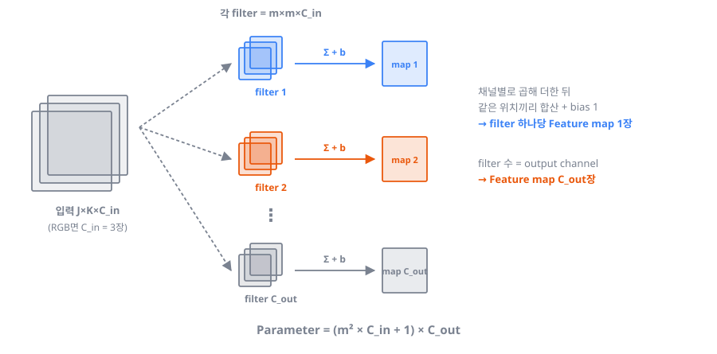
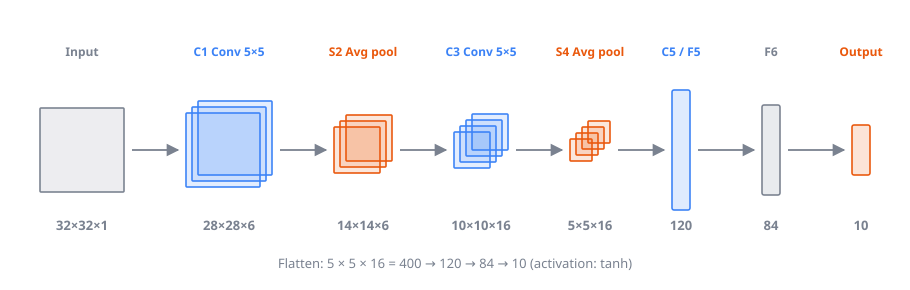

> 인공지능개론 (Deep Learning 2) 강의를 공부하며 정리한 글입니다.

---

[1편](/posts/CNN_Convolution_Padding_Pooling/)에서는 Channel이 하나인 image에서 Convolution, Padding, Stride, Pooling을 정리했습니다. 이번 편에서는 Channel이 여러 개인 경우와, 이를 조합한 실제 CNN 구조를 다룹니다.

## 1. Input channel과 Output channel

### 1.1 Channel이란

Color image는 pixel마다 R, G, B 값 3개를 가집니다. R 값끼리 모은 행렬, G 값끼리 모은 행렬, B 값끼리 모은 행렬을 각각 **Channel**이라고 합니다. JxK pixel, $C_{in}$개 channel인 image라면 input feature는 $J \times K \times C_{in}$개입니다.

### 1.2 Input channel

Input channel은 **filter의 두께**라고 생각하면 됩니다. Kernel도 input channel마다 따로 필요하므로(R용, G용, B용) filter 크기는 $m \times m \times C_{in}$입니다.

하나의 input data에 대해 $C_{in}$개(RGB면 3개) channel을 각각 계산한 뒤, **같은 위치의 값을 모두 더해** 하나의 output(Feature map 한 장)을 만듭니다.

- 그래서 weight parameter는 $m^2 \times C_{in}$개이지만, bias는 1개입니다.
- Kernel을 image 전체에 재사용하므로 parameter 수는 image 크기와 무관합니다.
- 결국 다 더해지므로 Feature map의 장수와 크기는 input channel 수의 영향을 받지 않습니다. 크기는 여전히 $\lfloor (J+2P-M)/S + 1 \rfloor$로만 정해집니다.

**예시**: input channel 2개 (3x3 input, 2x2 kernel, padding 0, stride 1 → 2x2 Feature map)

$$
\text{ch 1: }
\begin{bmatrix} 0 & 1 & 2 \\ 3 & 4 & 5 \\ 6 & 7 & 8 \end{bmatrix}
* \begin{bmatrix} 0 & 1 \\ 2 & 3 \end{bmatrix}
\qquad
\text{ch 2: }
\begin{bmatrix} 1 & 2 & 3 \\ 4 & 5 & 6 \\ 7 & 8 & 9 \end{bmatrix}
* \begin{bmatrix} 1 & 2 \\ 3 & 4 \end{bmatrix}
$$

$$
\begin{aligned}
\text{왼쪽 위} &= \underbrace{(0 \cdot 0 + 1 \cdot 1 + 3 \cdot 2 + 4 \cdot 3)}_{19} + \underbrace{(1 \cdot 1 + 2 \cdot 2 + 4 \cdot 3 + 5 \cdot 4)}_{37} = 56 \\
\text{오른쪽 위} &= \underbrace{(1 \cdot 0 + 2 \cdot 1 + 4 \cdot 2 + 5 \cdot 3)}_{25} + \underbrace{(2 \cdot 1 + 3 \cdot 2 + 5 \cdot 3 + 6 \cdot 4)}_{47} = 72
\end{aligned}
$$

$$
\text{결과} = \begin{bmatrix} 56 & 72 \\ 104 & 120 \end{bmatrix}
$$

### 1.3 Output channel

Output의 개수(Feature map 장수)를 정하는 것은 **Output channel**입니다.

Edge detection에서 봤듯이 filter(kernel set) 하나는 Horizontal이면 Horizontal, Vertical이면 Vertical처럼 **한 가지 feature만** 학습할 수 있어서 여러 속성을 잡을 수 없습니다. 그래서 kernel set을 $C_{out}$개 만들어, output channel을 통해 다양한 filter를 씌웁니다.

- Filter 하나는 Fully connected의 hidden node 하나와 비슷합니다. Hidden node는 모든 입력에 대한 weighted sum이고, filter는 특정 영역(patch)에 대한 weighted sum입니다.


_Filter 하나는 모든 input channel을 계산해 더한 Feature map 1장을 만들고, Filter 수가 곧 Output channel 수입니다_

| 구분           | 역할                                   | 계산 후                  |
|----------------|----------------------------------------|--------------------------|
| Input channel  | RGB처럼 입력이 가진 여러 성분을 다룸   | 모두 더해져 1장이 됨     |
| Output channel | 여러 종류의 feature를 학습하기 위해 여러 filter를 씀 | Feature map 장수가 됨 |

$$
\begin{aligned}
\text{Filter 차원} &= M \times M \times C_{in} \times C_{out} \\
\text{Parameter 수} &= (M^2 \times C_{in} + 1) \times C_{out}
\end{aligned}
$$

> **외우는 법: "filter size × input channel + bias 1, 이것이 output channel 수만큼"**

---

## 2. 일반적인 CNN 구조

```text
Input → Convolution → Pooling → Convolution → Pooling → Flatten → Fully connected → Softmax
```

- **Convolution layer**: 주변 pixel과의 관계(edge, 변화)를 계산합니다. Class 확률을 계산하는 layer가 아닙니다.
- **Fully connected layer**: Class 확률을 계산합니다. 대부분의 CNN은 맨 뒤에 이 layer를 둡니다. Classification이면 output neuron 수를 class 수에 맞춥니다.
- **Flatten**: 마지막 Feature map을 한 줄로 펴서 neuron으로 만듭니다.

Flatten 후 neuron 수는 Feature map 크기와 channel 수로 정해집니다 (아래 예시는 channel 1개 기준).

- 마지막 Feature map이 7x7이고 class가 10개면 `Linear(49, 10)`, 3x3이면 `Linear(9, 10)`입니다.
- Feature map이 6x6이면 neuron은 36개이고, hidden neuron이 128개면 weight는 $36 \times 128$개가 필요합니다.

> **Feature map 크기를 계산할 줄 알아야 마지막 Fully connected layer를 설계할 수 있습니다.** (교수님 강조) Channel 수까지 알아야 Flatten 후 `Linear(400, 120)`인지 `Linear(300, 120)`인지 정할 수 있습니다.

---

## 3. LeNet-5

LeNet-5는 Yann LeCun이 만든, 가장 기본이 되는 CNN입니다.

- 입력은 32x32, channel 1(grayscale)로 고정입니다. 28x28인 MNIST는 Padding이나 interpolation upscaling으로 맞춥니다.

### 3.1 Feature map 크기 흐름

| Layer                   | 계산                  | 출력 (Maps = output channel) | Parameter                     |
|-------------------------|-----------------------|------------------------------|-------------------------------|
| Input                   | -                     | 32x32x1                      | -                             |
| C1 Conv (kernel 5, s 1) | $(32-5)/1 + 1 = 28$   | 28x28x6                      | $(5 \times 5 \times 1 + 1) \times 6 = 156$    |
| S2 Avg pool (2x2, s 2)  | $(28-2)/2 + 1 = 14$   | 14x14x6                      | 0                             |
| C3 Conv (kernel 5, s 1) | $(14-5)/1 + 1 = 10$   | 10x10x16                     | $(5 \times 5 \times 6 + 1) \times 16 = 2{,}416$ |
| S4 Avg pool (2x2, s 2)  | $(10-2)/2 + 1 = 5$    | 5x5x16                       | 0                             |
| Flatten                 | $5 \times 5 \times 16$ | 400 neurons                 | -                             |


_LeNet-5의 Feature map 크기 흐름: Convolution과 Pooling을 두 번 반복한 뒤 Fully connected로 분류합니다_

- Pooling은 channel마다 따로 적용하므로 장수는 그대로이고 크기만 줄어듭니다. 학습할 parameter도 없습니다.
- C3의 input channel 6은 앞 layer의 output channel 6에서 온 것입니다.
- 슬라이드 20의 $(5 \times 5 \times 6 \times 10) + 16 = 1516$은 무시하라고 하셨습니다. 원래 LeNet은 6장을 전부 더하지 않고 일부씩 묶는 특수한 연결로 parameter를 줄였는데, 그 모델 고유의 구조라 잊어도 됩니다. 일반 Convolution이면 $(5 \times 5 \times 6 + 1) \times 16$이 맞습니다.

Fully connected layer의 parameter 수(weight + bias)는 다음과 같습니다.

| Layer               | 계산                        | Parameter |
|---------------------|-----------------------------|-----------|
| Dense 1 (400 → 120) | $400 \times 120 + 120$      | 48,120    |
| Dense 2 (120 → 84)  | $120 \times 84 + 84$        | 10,164    |
| Output (84 → 10)    | $84 \times 10 + 10$         | 850       |

### 3.2 Fully connected = 입력과 같은 크기의 Convolution

5x5x16에서 120으로 가는 layer는 두 가지로 표현할 수 있습니다.

1. Flatten해서 400개 입력 → 120 neuron Fully connected: $400 \times 120 + 120 = 48{,}120$
2. 5x5 kernel, input channel 16, output channel 120인 Convolution: $(5 \times 5 \times 16 + 1) \times 120 = 48{,}120$

Kernel 크기가 입력 크기와 같으면 출력은 $(5-5)/1 + 1 = 1$, 즉 1x1이고, 이는 입력 전체에 대한 weighted sum입니다. Kernel set 하나가 neuron 하나의 역할을 하므로, 120세트는 neuron 120개짜리 Fully connected와 같습니다.

> **그래서 LeNet-5를 검색하면 이 layer가 Convolution(C5)으로도, Fully connected(F5)로도 나옵니다.**

---

## 4. Convolution이 Parameter를 줄이는 이유

- Convolution의 weight 수는 filter 크기와 같습니다. 5x5 filter 하나는 $5 \times 5 + 1(\text{bias}) = 26$개의 parameter를 가집니다 (channel 무시).
- 32x32x1 입력을 Fully connected로 연결하면 hidden neuron이 1개여도 $1024 + 1 = 1025$개가 필요합니다.
- Fully connected는 feature마다 weight가 따로 있지만, Convolution은 같은 filter를 모든 위치에 곱합니다. 이것을 **Weight sharing**이라고 합니다.

> **Weight sharing 덕분에 Convolution은 전체 Parameter를 크게 줄입니다.**

---

## 5. PyTorch 구현

Filter를 직접 구현할 일은 크게 없고 `nn.Conv2d(in_channels, out_channels, kernel_size, stride, padding)`를 씁니다. 앞의 두 숫자가 input / output channel입니다.

```python
self.c1 = nn.Conv2d(1, 6, kernel_size=5, stride=1, padding=2)
self.c3 = nn.Conv2d(6, 16, kernel_size=5, stride=1, padding=0)
self.c5 = nn.Conv2d(16, 120, kernel_size=5, stride=1, padding=0)
self.pool = nn.AvgPool2d(kernel_size=2, stride=2)
self.f6 = nn.Linear(120, 84)
self.output = nn.Linear(84, num_classes)
self.tanh = nn.Tanh()
```

- MNIST는 28x28x1인데 LeNet-5는 32x32 입력용이므로 `c1`에 `padding=2`를 넣어 32x32로 맞춥니다. 입력이 32x32면 padding 0, 30x30이면 padding 1입니다.
- `Linear` 입력이 400이 아닌 이유는 위에서 본 것처럼 `c5`가 5x5 Convolution으로 이미 120을 만들기 때문입니다. 그래서 다음 `Linear`는 120에서 시작합니다.
- **Implementation (2)**: `c5` 대신 `self.f5 = nn.Linear(400, 120)`을 써도 됩니다. 단, Fully connected는 Flatten 이후에 와야 하므로 forward에서 `torch.flatten` 아래로 위치가 옮겨집니다. Parameter 수(48,120)는 동일합니다.
- `torchsummary.summary(model, input_size=(1, 28, 28))`로 각 layer의 output shape과 parameter 수(156, 2,416, 48,120, 10,164, 850)를 확인할 수 있습니다.
- Activation function은 tanh를 씁니다.
- MNIST batch training 코드와 거의 같고, 모델 선언 부분과 forward propagation 순서만 다릅니다.

| 모델            | MNIST  | Fashion-MNIST |
|-----------------|--------|---------------|
| Fully connected | -      | 약 81%        |
| LeNet-5         | 97.92% | 85.92%        |

---

## 6. CIFAR-10 & CIFAR-100

### 6.1 Dataset

- **CIFAR-10**: 32x32 RGB color image, 10개 class(airplane, automobile, bird, cat, …), class당 6,000장입니다. 개수는 외우지 않아도 되지만 **32x32, RGB**라는 것은 기억해야 합니다.
- **CIFAR-100**: 100개 class, class당 600장(training 500 / test 100)입니다.
  - Label이 두 개입니다. 세부 class 100개(**fine label**)와 superclass 20개(**coarse label**)이고, superclass 하나 아래에 class가 5개씩 묶여 있습니다.
  - 예: bicycle, bus, motorcycle, pickup truck, train → vehicles 1 / bee, beetle, butterfly, caterpillar, cockroach → insects
  - 그래서 100-class 분류도, 20-class 분류도 할 수 있습니다.

### 6.2 LeNet-5를 CIFAR에 쓰려면

1. **Padding**: CIFAR는 이미 32x32이므로 `padding=0`입니다.
2. **Input channel**: 첫 Convolution layer의 input channel을 1 → 3으로 바꿉니다. 뒤쪽 Feature map 개수나 크기는 바뀌지 않습니다(input channel은 계산 후 더해지므로).
3. **Output**: CIFAR-100이면 마지막 output layer를 100(superclass면 20)으로 바꿉니다.

Color image라고 항상 RGB 3 channel인 것은 아닙니다. 투명도까지 4 channel이거나 명도·채도 등 다른 표현일 수도 있으니 data에 맞게 input channel 수를 정합니다.

### 6.3 Feature map 크기 예시 (32x32, kernel 3x3)

| 조건                | 계산                                     | 결과   |
|---------------------|------------------------------------------|--------|
| Padding 없음        | $32 - 3 + 1 = 30$                        | 30x30  |
| Padding 2           | $32 + 2 \times 2 - 3 + 1 = 34$ (양쪽이라 2를 두 번 더함) | 34x34  |
| Padding 2, Stride 2 | $\lfloor (32 + 2 \times 2 - 3)/2 + 1 \rfloor = 17$ | 17x17  |

### 6.4 Normalization

```python
transform = transforms.Compose([
    transforms.ToTensor(),
    transforms.Normalize((0.4914, 0.4822, 0.4465), (0.2023, 0.1994, 0.2010))
])
```

- 필수는 아니지만 입력 data의 범위를 맞추기 위해 보통 합니다. 숫자는 외울 필요가 없습니다.
- `Normalize(mean, std)`는 $(\text{input} - \text{mean}) / \text{std}$, 즉 **z-score normalization**을 R, G, B channel마다 따로 적용합니다.
- 적용 후에도 shape(32x32x3)은 그대로이고, 각 channel의 평균은 대략 0, 표준편차는 대략 1이 됩니다.

---

## 7. 정리

- Input channel은 filter의 두께이고, channel별 계산 결과를 **모두 더해** Feature map 1장을 만듭니다. Output channel은 filter 수이고 곧 Feature map 장수입니다.
- Convolution layer의 Parameter 수는 $(M^2 \times C_{in} + 1) \times C_{out}$이며, Weight sharing 덕분에 image 크기와 무관합니다.
- CNN은 Convolution → Pooling을 반복한 뒤 Flatten → Fully connected로 분류합니다. Feature map 크기와 channel 수를 계산할 줄 알아야 Fully connected layer를 설계할 수 있습니다.
- LeNet-5: 32x32x1 → 28x28x6 → 14x14x6 → 10x10x16 → 5x5x16(400) → 120 → 84 → 10. 입력 크기와 같은 kernel의 Convolution은 Fully connected와 같습니다.
- CIFAR에 적용하려면 Padding, input channel(1 → 3), output 수만 바꾸면 됩니다.
