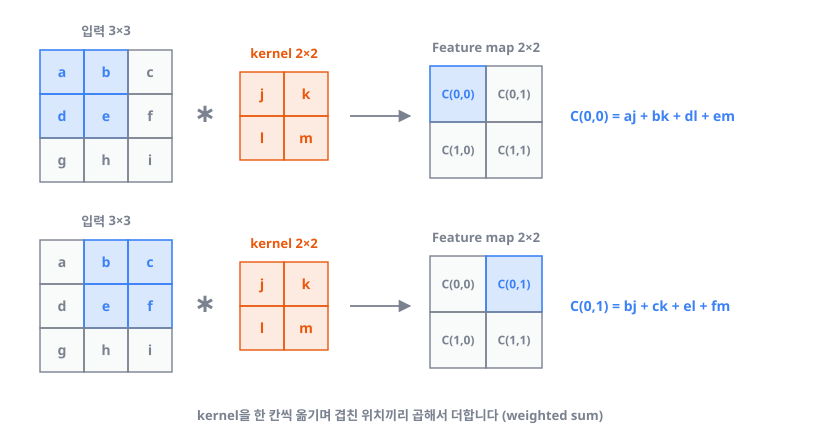
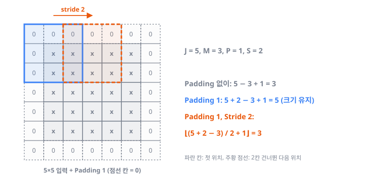
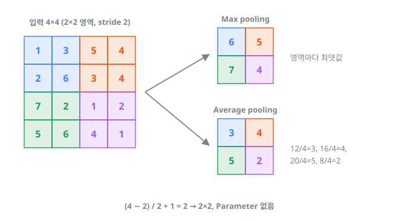
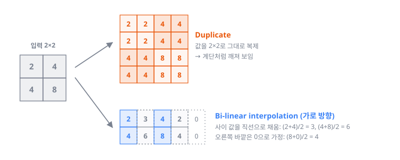

> 인공지능개론 (Deep Learning 2) 강의를 공부하며 정리한 글입니다.

---

## 1. Image data의 구조

- Image는 **pixel의 2D 배열**입니다. pixel이 많을수록 고화질입니다.
- **Grayscale**은 pixel마다 밝기 값 1개를, **Color**는 RGB 값 3개를 가집니다.
- 값은 보통 `uint8`로 표현하며 $0 \sim 2^8-1 = 255$ 범위입니다. 실제로는 그대로 쓰지 않고 대부분 **Normalization**을 거칩니다.

| Dataset  | 크기  | Channel        | Input feature 수           |
|----------|-------|----------------|----------------------------|
| CIFAR-10 | 32x32 | RGB (3)        | $32 \times 32 \times 3 = 3{,}072$ |
| MNIST    | 28x28 | Grayscale (1)  | $28 \times 28 = 784$       |

---

## 2. 왜 Convolution이 필요한가

### 2.1 Image를 Flatten하면 생기는 문제

Image data를 일반적인 data처럼 **Flatten**해서 한 줄로 쓰면 다음 문제가 생깁니다.

1. **Parameter가 지나치게 많아집니다.**
   Fully connected layer는 모든 input에 weight가 필요합니다. 720x720x3 image라면 input만 약 155만 개라 memory를 많이 쓰고 weighted sum 계산도 오래 걸립니다. 28x28 MNIST도 input 784개에 hidden 128개면 weight가 약 10만 개입니다.
2. **Local correlation이 사라집니다.**
   Image는 주변 pixel과의 관계가 중요합니다. 집값 data나 Iris(꽃 특징) data는 feature 순서를 바꿔도 학습과 테스트의 순서만 같으면 문제가 없지만, image는 pixel을 섞으면 무엇인지 알 수 없습니다. 숫자 1을 알아보는 것도 "까맣다가, 일렬로 하얗다가, 다시 까맣다"는 주변과의 관계 덕분입니다.
3. **변환에 대응할 수 없습니다.**
   Image를 돌리거나 확대하거나 옮기면 같은 위치의 pixel 값은 완전히 달라지지만, 해석(같은 물체라는 것)은 유지되어야 합니다. 한 줄로 펴서 위치별로 weight를 주면 이것을 처리할 수 없습니다.

### 2.2 Invariance와 Equivariance

이 문제를 풀기 위해 먼저 두 성질을 알아봅니다.

**Invariance**는 입력이 변해도 출력이 동일해야 한다는 성질입니다. 예를 들어 고양이 사진을 확대하거나 잘라도 고양이 사진이라는 결과는 바뀌면 안 됩니다. (Image classification)

$$
f[\mathbf{x}] = f[t(\mathbf{x})]
$$

**Equivariance**는 입력이 변한 만큼 출력도 변해야 한다는 성질입니다. 예를 들어 사진에서 소파가 오른쪽으로 옮겨지면, Segmentation 결과(pixel마다 소파/테이블/바닥 등을 표시한 mask)의 소파 영역도 똑같이 오른쪽으로 옮겨져야 합니다. (Image segmentation)

$$
f[t(\mathbf{x})] = t[f(\mathbf{x})]
$$

즉 image를 먼저 옮기고 Segmentation한 결과와, Segmentation한 뒤 결과를 옮긴 것이 같아야 합니다.

| 성질         | 식                     | 의미                   | 예                   |
|--------------|------------------------|------------------------|----------------------|
| Invariance   | $f[x] = f[t(x)]$       | 입력이 변해도 출력 동일 | Image classification |
| Equivariance | $f[t(x)] = t[f(x)]$    | 입력이 변한 만큼 출력도 변화 | Image segmentation   |

사람도 "(5, 5) 값이 255"처럼 절대 위치로 인식하지 않고, 주변보다 밝은지 어두운지로 판단하기 때문에 변환에 강합니다. 이처럼 주변 pixel을 함께 보도록 만든 것이 **Convolution layer**입니다.

> **Convolution layer를 하나라도 포함하면 Convolutional Neural Network, 즉 CNN이라고 부릅니다.**

---

## 3. Edge detection

**Edge detection**은 사물의 모서리에 주목해 특징을 잡습니다. 각 pixel에서 주변 값을 빼면 변화가 없는 곳은 사라지고 변화가 큰 곳만 남습니다. 변화는 주로 사물의 가장자리에서 일어나므로 이것이 Edge detection입니다.

- 왼쪽과 오른쪽의 차이를 구하면 **세로 방향 edge**를 찾습니다.
- 위와 아래의 차이를 구하면 **가로 방향 edge**를 찾습니다.

$$
\underbrace{\begin{bmatrix} -1 & 0 & 1 \\ -1 & 0 & 1 \\ -1 & 0 & 1 \end{bmatrix}}_{\text{Vertical edge}}
\qquad
\underbrace{\begin{bmatrix} -1 & -1 & -1 \\ 0 & 0 & 0 \\ 1 & 1 & 1 \end{bmatrix}}_{\text{Horizontal edge}}
\qquad
\underbrace{\begin{bmatrix} -1 & -1 & -1 \\ -1 & 8 & -1 \\ -1 & -1 & -1 \end{bmatrix}}_{\text{Laplacian}}
$$

- **Vertical**: 왼쪽 값을 빼고 오른쪽 값을 더합니다. 결과가 양수면 왼쪽이 어둡고 오른쪽이 밝고(dark → bright), 음수면 반대(bright → dark)입니다. 부호를 뒤집은 filter를 써도 원리는 같습니다.
- **Horizontal**: 위쪽 값을 빼고 아래쪽 값을 더합니다. 가로 edge에는 반응하지만 세로 edge에는 거의 반응하지 않습니다. 예를 들어 일자 눈썹은 Horizontal에서 선명하고 Vertical에서는 거의 보이지 않습니다.
- **Laplacian**: 자신과 주변 전체를 비교하므로 모든 방향의 edge를 찾습니다. 배경처럼 주변과 값이 같으면 0이 되고, 값이 변하는 곳에서만 0이 아닙니다.

---

## 4. Filter(Kernel)와 Convolution 계산

### 4.1 Filter는 곧 Weight

이 계산에는 **Filter(Kernel)**를 사용합니다. MxN 크기의 사각형을 image 위에서 이동시키며, 각 위치의 값을 곱하고 더합니다(weighted sum).

- Fully connected는 모든 input에 weight를 곱해 더하지만, Convolution layer는 **관심 있는 영역만** 곱해 더합니다.
- Kernel 값은 위의 edge kernel처럼 고정된 것이 아니라 **학습되는 weight**입니다. 학습을 통해 어떤 edge(특징)를 찾을지 결정됩니다.

> **Filter는 곧 Weight이고, 어떤 특징을 찾을지는 학습으로 정해집니다.**

### 4.2 계산 예시

3x3 image(a ~ i)에 2x2 kernel(j k / l m)을 적용하면 다음과 같습니다.

$$
\begin{aligned}
C(0,0) &= aj + bk + dl + em & C(0,1) &= bj + ck + el + fm \\
C(1,0) &= dj + ek + gl + hm & C(1,1) &= ej + fk + hl + im
\end{aligned}
$$


_Kernel을 한 칸씩 옮기며 겹친 위치끼리 곱해 더하면 Feature map의 한 칸이 됩니다_

### 4.3 MNIST 예시

0 ~ 1로 Normalization한 5x5 영역에 3x3 kernel을 적용하면 3x3 Feature map이 나옵니다.

$$
\underbrace{\begin{bmatrix}
0.0 & 0.0 & 0.0 & 0.0 & 0.0 \\
0.0 & 0.0 & 0.3 & 0.7 & 0.6 \\
0.0 & 0.0 & 0.9 & 1.0 & 1.0 \\
0.0 & 0.0 & 0.3 & 0.4 & 0.3 \\
0.0 & 0.0 & 0.0 & 0.0 & 0.0
\end{bmatrix}}_{\text{입력 영역}}
\qquad
\underbrace{\begin{bmatrix}
0.4 & 1.7 & 0.9 \\
2.3 & -2.1 & 4.0 \\
-1.4 & 0.7 & 2.1
\end{bmatrix}}_{\text{Kernel}}
$$

첫 칸은 0이 아닌 항만 남아 $0.3 \times 4.0 + 0.9 \times 2.1 = 3.09$입니다.

**Check-in quiz**: 같은 입력에 Vertical kernel을 적용하면 아래와 같습니다. 왼쪽과 오른쪽의 차이가 드러나므로 그 위치에 pixel 변화가 있음을 알 수 있습니다.

$$
\begin{bmatrix}
1.2 & 1.7 & 0.4 \\
1.5 & 2.1 & 0.4 \\
1.2 & 1.4 & 0.1
\end{bmatrix}
$$

나온 Feature map에 다시 kernel을 적용해 Convolution layer를 여러 층 쌓을 수 있습니다.

### 4.4 Feature map 계산 코드

```python
img = Image.open("dog.png").convert("L")   # grayscale로 변환
image_array = np.array(img, dtype=np.float32)
H, W = image_array.shape
padded = np.pad(image_array, pad_width=1, mode="constant", constant_values=0)
feature_map = np.zeros((H, W), dtype=np.float32)
for row in range(H):
    for col in range(W):
        patch = padded[row:row+3, col:col+3]
        feature_map[row, col] = np.sum(patch * filter)  # assume no bias
```

- 양쪽에 padding 1을 넣으므로 Feature map 크기는 $(H+2-3+1) \times (W+2-3+1) = H \times W$로 입력과 같습니다.
- `row:row+3`은 `row`, `row+1`, `row+2`를 뜻합니다. 이 3x3 patch에 filter를 곱해 모두 더한 값이 feature 하나가 되고, 오른쪽으로 옮기며 반복합니다.

> **이 이중 for문이 Convolution layer의 전부입니다.**

---

## 5. Feature map의 크기

### 5.1 기본

JxK 크기의 입력 image에 MxN kernel을 쓰면 **Feature map**의 크기는 다음과 같습니다.

$$
(J - M + 1) \times (K - N + 1)
$$

한쪽 끝에 kernel을 놓으면 $J-M$ pixel이 남고, 한 칸씩 움직이므로 처음 위치 1을 더합니다.

### 5.2 Padding

Convolution을 하면 크기가 줄어듭니다. 입력 크기를 유지하고 싶을 때 **Padding**을 사용합니다. Padding은 image 주위에 가짜 값(주로 0)을 채워 넣는 것입니다.

$$
(J + 2P - M + 1) \times (K + 2P - N + 1)
$$

- Padding은 image 가장자리 값에 가중치를 주기에도 좋습니다. Padding이 없으면 가장자리 pixel은 kernel 계산에 덜 들어갑니다.
- 원래 image 크기로 만들려면 $J + 2P - M + 1 = J$이므로 $P = (M-1)/2$로 잡으면 됩니다.
- MNIST(28x28, 3x3 kernel): padding 없음 → 26x26, $P = 1$ → $28 + 2 - 3 + 1 = 28$ → 28x28

### 5.3 Stride

Image가 너무 커서(예: 720x720) Filter를 모든 위치에서 계산하기 부담스러우면, **Stride** $S$만큼 건너뛰며 계산할 수 있습니다.

$$
\left\lfloor \frac{J + 2P - M}{S} + 1 \right\rfloor \times \left\lfloor \frac{K + 2P - N}{S} + 1 \right\rfloor
$$

항상 나누어떨어지지는 않으므로 양쪽 모두 반내림(floor)합니다. Stride로 건너뛰다가 끝에서 filter가 더 들어갈 자리가 없으면 그 칸은 계산에서 빠지기 때문입니다.

- MNIST(28x28, 3x3 kernel), $P = 1$, $S = 2$ → $\lfloor (28+2-3)/2 + 1 \rfloor = 14$ → 14x14
- 14x14, 3x3 kernel, $P = 2$, $S = 3$ → $\lfloor 15/3 + 1 \rfloor = 6$ → 6x6


_5x5 입력에 Padding 1을 두르고 3x3 kernel을 Stride 2로 이동하면 3x3 Feature map이 나옵니다_

| 조건            | Feature map 크기 (한 변)                         |
|-----------------|--------------------------------------------------|
| 기본            | $J - M + 1$                                      |
| Padding $P$     | $J + 2P - M + 1$                                 |
| Padding + Stride | $\lfloor (J + 2P - M)/S + 1 \rfloor$            |

> **세 공식은 모두 마지막 식의 특수한 경우입니다 ($P = 0$, $S = 1$).**

---

## 6. Downsampling

Image(Feature map)가 너무 커서 전부 계산하면 오래 걸릴 때, Convolution layer와 함께 크기를 1/2, 1/4 등으로 줄이는 데 사용합니다.

1. **Stride**: 듬성듬성 계산해 크기를 줄입니다.
2. **Pooling**: 일단 계산한 뒤, 영역마다 값 하나로 줄입니다. DxD 영역 크기와 stride를 정하며, 크기 계산은 Convolution과 같은 공식을 씁니다.
   - **Max pooling**: 일정한 영역에서 최댓값 하나를 선택합니다.
   - **Mean(Average) pooling**: 영역의 평균을 계산해 선택합니다.

크기 예시는 다음과 같습니다.

- 4x4 입력, 2x2 pooling, stride 2 → $(4-2)/2 + 1 = 2$ → 2x2. 일반적으로 이렇게 영역이 겹치지 않게 씁니다.
- 4x4 입력, 3x3 pooling, stride 1 → $(4-3)/1 + 1 = 2$ → 역시 2x2입니다.
- 슬라이드의 Average pooling(2x2, stride 2) 예시: $12/4 = 3$, $16/4 = 4$, $20/4 = 5$, $8/4 = 2$


_같은 4x4 입력에 2x2 Max pooling과 Average pooling(stride 2)을 적용한 결과 (예시 값)_

---

## 7. Upsampling

Feature map에는 잘 쓰이지 않지만, 입력 image가 저화질처럼 크기가 너무 작을 때 키우는 데 사용합니다.

1. **Duplicate**: 같은 값으로 복제합니다. 한 점을 2x2, 3x3 등으로 그대로 복제합니다. 작은 image를 크게 늘렸을 때 화질이 깨져 보이는 현상이 이것입니다.
2. **Max unpooling**: Max pooling에서 왔다고 가정하고, 이 값을 최댓값으로 두고 나머지를 이보다 작은 값으로 채웁니다. 어떤 작은 값을 쓸지 알 수 없어 잘 사용하지 않습니다.
3. **Bi-linear interpolation**: 가장 많이 씁니다. 두 점을 직선으로 이어 그 사이를 연속된 값으로 채웁니다.
   - 0과 6 사이에 1개를 넣으면 3, 2개를 넣으면 2, 4입니다.
   - 2, 4, 4, 8 예시에서 2와 4 사이는 3, 4와 8 사이는 6입니다.
   - 오른쪽 끝은 Padding처럼 바깥을 0으로 가정합니다. 그래서 8과 0 사이는 4입니다.


_Duplicate는 값을 그대로 복제하고, Bi-linear interpolation은 사이 값을 직선으로 채웁니다_

| 방법                   | 방식                         | 특징                 |
|------------------------|------------------------------|----------------------|
| Duplicate              | 같은 값 복제                 | 화질이 깨져 보임     |
| Max unpooling          | 최댓값 + 나머지는 작은 값    | 채울 값이 모호해 잘 안 씀 |
| Bi-linear interpolation | 두 점 사이를 직선으로 채움  | 가장 많이 씀         |

---

## 8. 정리

- Image를 Flatten하면 Parameter가 폭증하고, Local correlation이 사라지며, 변환에 대응하지 못합니다. 그래서 주변 pixel을 함께 보는 **Convolution layer**를 씁니다.
- Filter(Kernel)는 학습되는 weight이고, image 위를 이동하며 weighted sum으로 **Feature map**을 만듭니다.
- Feature map 크기는 $\lfloor (J + 2P - M)/S + 1 \rfloor$ 하나로 계산합니다. $P = (M-1)/2$면 크기가 유지됩니다.
- **Pooling**은 크기를 줄이고(Max / Average), **Upsampling**은 크기를 키웁니다(주로 Bi-linear interpolation).

다음 편에서는 RGB처럼 여러 **Channel**을 가진 입력을 어떻게 계산하는지, 그리고 이를 조합한 **LeNet-5** 구조와 PyTorch 구현을 정리합니다.
